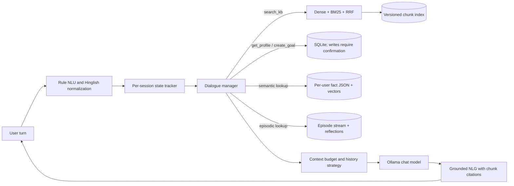

# RecallBot V12

RecallBot is the individual PCA MZG517 Mini Project 1 build for **V12 — GM CHANDRA KISHORE**:

| Allocation | Value |
|---|---|
| Domain | Personal budgeting coach |
| Twist | D. Code-mixed input |
| Short-term trim window | 6 turns |
| Context window | 4,096 tokens |
| Scale assumption | 100,000 daily users |

The existing Cloud Resource & Cost Optimization Advisor in the parent workspace is untouched.
This project is in its own `RecallBot` directory.

## What is implemented

- Rule-based NLU and code-mixed query normalization, with a 20-utterance accuracy evaluator.
- A dialogue manager, in-memory per-session state tracker, savings-goal slot filling, and a
  SQLite write that is gated on an explicit confirmation.
- Eighteen versioned budgeting-guide files (17 document IDs, including old and new versions of
  `BUD-102`), 25 retrieval questions, 16 probes, and a 42-turn A/B scripted conversation. The
  knowledge base is 6,223 words at generation time.
- Token-counted overlapping chunks at 128 and 512 tokens, dense retrieval, a locally implemented
  BM25 scorer, and locally implemented reciprocal-rank fusion.
- Per-user semantic facts with supersession, episodic memory with recency/importance/relevance,
  end-of-session reflections, and deletion of matching facts, vectors, episodes, and reflections.
- Full, trim, and rolling-summary history strategies; four retrieval/memory ablations; append-only
  runtime call logging; retrieval, NLU, vector-sizing, and index-benchmark commands.
- Ollama chat and embedding integrations, plus a clearly labelled deterministic template engine
  for offline smoke tests. Template runs are **not** LLM evaluation evidence.

## Setup (Windows PowerShell)

Python 3.10+ is required. Install Ollama separately if using the local model option.

```powershell
cd C:\Users\gmkis\Assignments\RecallBot
py -3.12 -m venv .venv
.\.venv\Scripts\Activate.ps1
python -m pip install -e ".[evaluation,test]"
python -m pip install -e ".[embeddings]"   # only for Sentence Transformers
```

Default live configuration uses Ollama. Pull the chat and embedding models, then ensure Ollama is
running:

```powershell
ollama pull llama3.1:8b
ollama pull nomic-embed-text
```

The project uses `tiktoken`'s `cl100k_base` encoding when installed; the local model's tokenizer is
not exposed by every Ollama release. The README/report must state this limitation when measuring
token windows. The standard-library fallback exists only so unit tests can run without optional
packages.

## Reproducible runs

Validate the allocated data and measure NLU:

```powershell
python -m recallbot validate-data
python -m recallbot evaluate-nlu
```

Build both vector indexes using the same embedding model for documents and queries:

```powershell
python -m recallbot build-index --embedding-backend ollama --embedding-model nomic-embed-text
python -m recallbot evaluate-kb --embedding-backend ollama --embedding-model nomic-embed-text
python -m recallbot compare-code-mix
```

`evaluate-kb` writes `results/hit_rate.csv` and the ranked evidence in
`results/rankings.json`. Hit rows retain the `code`, `paraphrase`, and version-specific question
type, and score document ID **and** version.

For Task 2, use the same chat model and decoding settings for each strategy. Each command is a
separate process and each unique user suffix starts a clean memory namespace:

```powershell
python -m recallbot run --session A --config full --user U1_full --run-id task2-full
python -m recallbot run --session A --config trim --user U1_trim --run-id task2-trim
python -m recallbot run --session A --config summary --user U1_summary --run-id task2-summary
python -m recallbot metrics
```

For Task 4, run Session A and then Session B in separate processes for each configuration. Use
the **same** user suffix for A and B within one configuration; do not reuse it across configurations:

```powershell
python -m recallbot run --session A --config no_rag --user U1_no_rag --run-id t4-no-rag-a
python -m recallbot run --session B --config no_rag --user U1_no_rag --run-id t4-no-rag-b
python -m recallbot run --session A --config hybrid --user U1_hybrid --run-id t4-hybrid-a
python -m recallbot run --session B --config hybrid --user U1_hybrid --run-id t4-hybrid-b
python -m recallbot run --session A --config hybrid_sem --user U1_hybrid_sem --run-id t4-sem-a
python -m recallbot run --session B --config hybrid_sem --user U1_hybrid_sem --run-id t4-sem-b
python -m recallbot run --session A --config hybrid_mem --user U1_hybrid_mem --run-id t4-mem-a
python -m recallbot run --session B --config hybrid_mem --user U1_hybrid_mem --run-id t4-mem-b
python -m recallbot evaluate-facts --config hybrid_sem --user U1_hybrid_sem
python -m recallbot compare-episodes --config hybrid_mem --user U1_hybrid_mem
python -m recallbot run-probes --config hybrid_mem --user U1_hybrid_mem --run-id probes-mem
python -m recallbot review-probes
python -m recallbot review-dialogue --config no_rag --user U1_no_rag
python -m recallbot review-dialogue --config hybrid --user U1_hybrid
python -m recallbot review-dialogue --config hybrid_sem --user U1_hybrid_sem
python -m recallbot review-dialogue --config hybrid_mem --user U1_hybrid_mem
```

The `run-probes` command stores raw answers but leaves correctness blank. Review every answer
yourself with `review-probes`; it records `judged_by=manual`. Call logs are append-only and are
never edited or cleared by the application. Start a new `--run-id` for each retry.

Vector size uses the stated variant scale and visible assumptions:

```powershell
python -m recallbot vector-sizing --chunk-size 128 --facts-per-user 8 --episodes-per-user-daily 1
python -m recallbot benchmark-kb-index --chunk-size 128 --vectors 100000 --queries 100
```

The FAISS command compares the actual KB-question embeddings against flat search on an index
padded to at least 100,000 vectors. It reports its padding count so the synthetic vectors are not
mistaken for KB content. For monthly cost, use the exact CS3 price row and run IDs from your own
Session A/B measurements:

```powershell
python -m recallbot cost-estimate `
  --trim-run-ids task5-trim-a,task5-trim-b `
  --hybrid-run-ids task5-mem-a,task5-mem-b `
  --price-row "<exact CS3 model row>" `
  --input-price <USD_per_million_input> `
  --output-price <USD_per_million_output> `
  --cached-input-price <USD_per_million_cached_input> `
  --embedding-price <USD_per_million_embedding_input> `
  --cache-min-tokens <model_minimum>
```

Run the deterministic tests:

```powershell
python -m pytest tests\
```

The template engine can be selected with `--engine template` for offline flow tests; these outputs
must not be presented as model-generated results. Live runs fail explicitly if Ollama is
unavailable or the selected model is missing.

## Architecture



The session state is deliberately in process memory; Session B is a separate process and can only
recover long-term data from the JSON stores and the SQLite database. `skills/` files are loaded at
runtime as procedural memory. Context assembly measurements and cited IDs are appended to
`results/context_assembly.jsonl`.

## Scope and evidence still needed before submission

This is a working project scaffold, not a finished submission report. Do not claim results that
are not present in the generated logs and outputs:

- The five surprise probes were not posted when this project was created (the LMS says
  24/11/2026); add them to `data/surprise_probes.json` and report raw results later.
- The assignment PDF states the expected CS4 BM25 score (4.160) and RRF order, but does not include
  the worked-example inputs. The CS4 course slides are available in the authenticated course
  materials, and `tests/test_retrieval.py` now checks the full example counts/statistics to 3
  decimals (4.160) plus the exact RRF ranking and E/F tie.
- The CS3 price table is not attached to the assignment page. Supply its model row and prices before
  producing a token-cost estimate; do not infer rates.
- Live model, embedding, 100,000-vector FAISS timing/recall, 15-reply quality ratings, the three
  failure traces, and the final eight-page report must come from your own measured runs. No
  synthetic call log, hit-rate table, or probe judgment is included as evidence.
- The variant requires code-mixed turns to be at least 30%. The scripted data exceeds that threshold;
  run the tokenizer comparison command/report from your own model tokenizer before claiming token
  cost differences.

The one-year vector count in `vector-sizing` uses explicit assumptions (default: 8 semantic facts
per user and 1 episode per user per day). Replace them with measured rates and state the assumptions.
The benchmark uses seeded random vectors to make flat/HNSW comparison reproducible; also report
the HNSW recall of the real budgeting questions from the actual index.

## AI-use declaration and demo

`report/AI_USE_DECLARATION_DRAFT.md` is a draft to verify and personalize. Record the tools you
actually used, one suggestion you found unsuitable, how you verified it, and what you changed.
`video_link.txt` is intentionally a placeholder until you record and publish your own voice-over
demo. Do not submit either placeholder unchanged.
